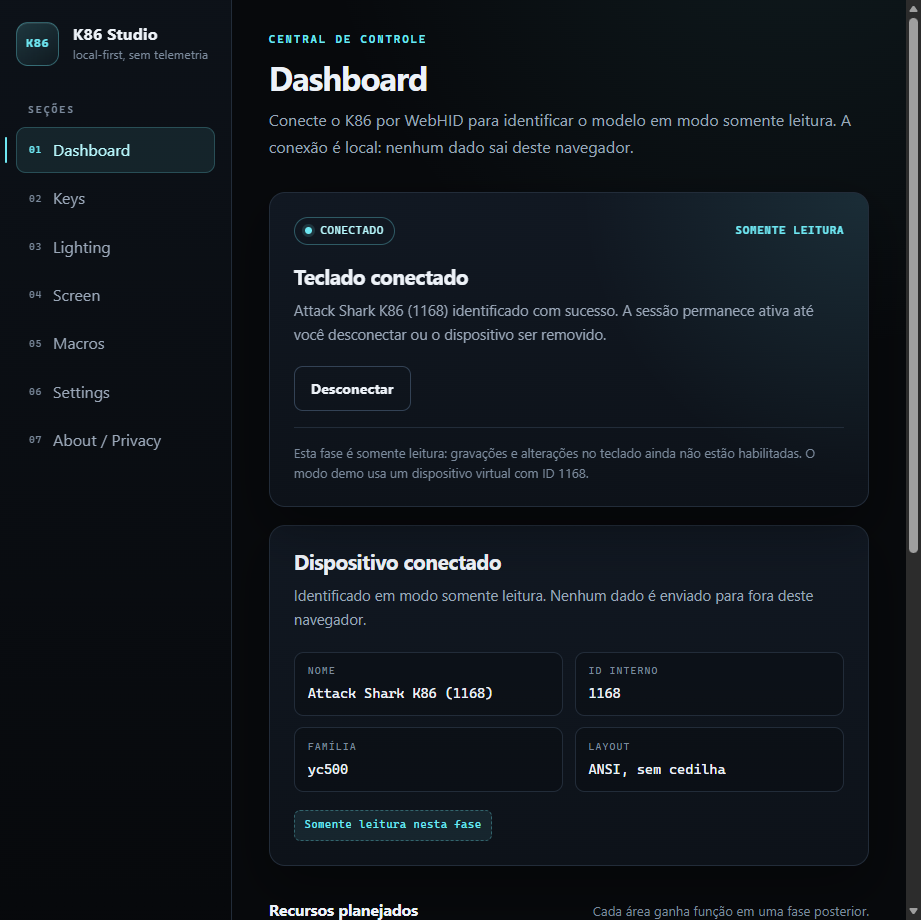
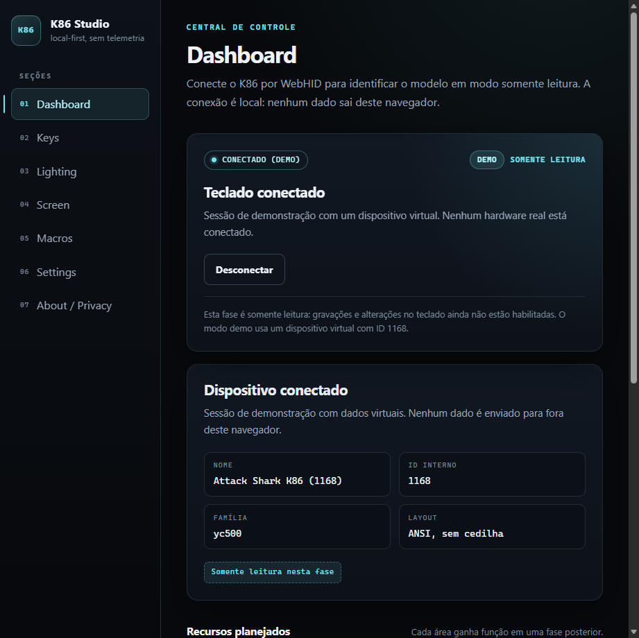
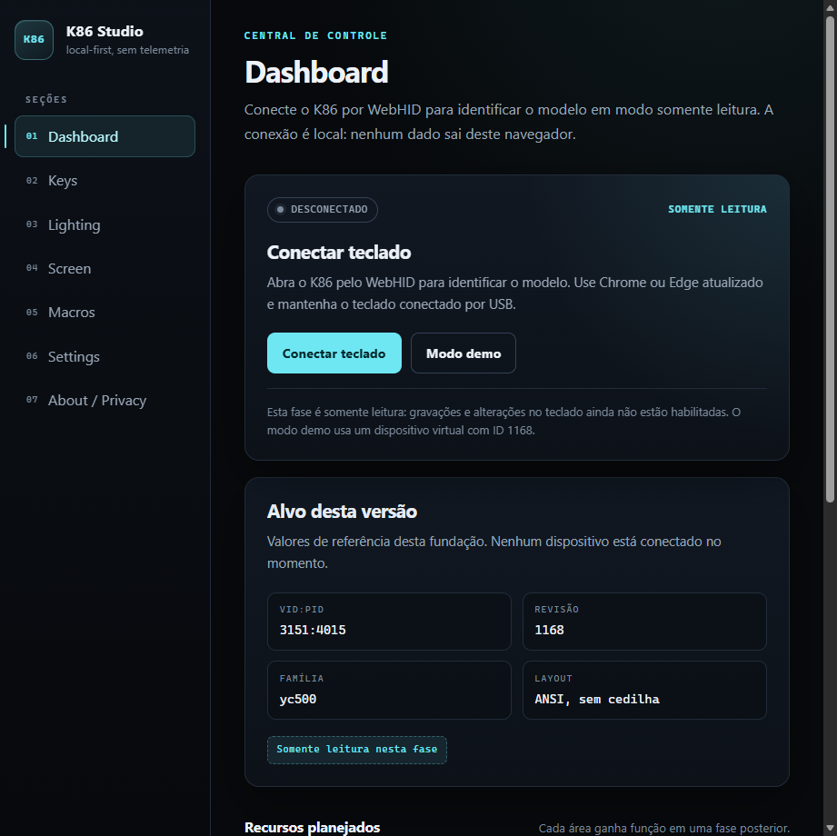

# Checklist de hardware — K86 Studio (fundação)

> **Nota:** este registro cobre apenas a fundação somente leitura. A validação
> de gravação da tela e dos GIFs está em
> [`screen-hardware.md`](screen-hardware.md), com o protocolo em
> [`../analysis/protocol-k86-screen.md`](../analysis/protocol-k86-screen.md).

- **Execução registrada:** 2026-11-12
- **Status:** executado com sucesso
- **Host:** Windows 11
- **Navegador:** Microsoft Edge 157.0.4341.46
- **App:** `http://127.0.0.1:5173`
- **Alvo:** `3151:4015`, ID interno `1168`, família `yc500`, ANSI sem cedilha
- **Dispositivo observado:** `USB\VID_3151&PID_4015`, interface vendor-defined
  `MI_02`, rótulo do chooser “Gaming Keyboard”
- **Escopo:** identificar o teclado e conferir o modo somente leitura
- **Gravação de configuração:** não habilitada nesta fase
- **Firmware:** nenhuma atualização é executada

> **Execução 2026-11-12:** os resultados abaixo foram registrados na primeira
> conexão WebHID real, com o K86 físico conectado por cabo USB. O único
> tráfego HID foi o feature report de identify; nenhuma gravação de
> configuração, keymap, RGB, macro, tela, perfil ou firmware foi enviada.
>
> **Para reexecutar:** use os mesmos passos e preencha o
> [template de reexecução](#template-de-reexecução-em-branco) ao final. Os
> resultados observados em 2026-11-12 ficam preservados como referência.

## Pré-condições

- [x] Cabo USB disponível para conectar o Attack Shark K86 com fio. O alvo é a
      conexão com fio; receptor 2.4 GHz ou Bluetooth não são o alvo desta
      validação.
- [x] Chrome ou Edge atualizado, com suporte a WebHID. Execução: Microsoft
      Edge 157.0.4341.46.
- [x] Driver/app oficial do fabricante **fechado**, para não disputar o
      dispositivo com o navegador.
- [x] Nenhum outro programa usando a interface HID do teclado.
- [x] Backup **não se aplica** nesta fase: o app não altera keymap, RGB,
      macros, perfis, tela ou firmware; o único tráfego HID é o feature report
      de identify. Se uma fase futura habilitar gravações de configuração, o
      backup/restore passa a ser obrigatório antes de qualquer teste.
- [x] Node.js portátil em `C:\Users\vitor\Tools\node-v26.13.1-win-x64`
      disponível. Não altere o Node do sistema.
- [x] Terminal aberto em `C:\Users\vitor\Projects\k86-studio`.

Verificação opcional, somente leitura, de que o Windows enumerou o alvo:

```powershell
Get-PnpDevice -PresentOnly |
  Where-Object { $_.InstanceId -match 'VID_3151&PID_4015' } |
  Select-Object Status, Class, FriendlyName, InstanceId
```

**Esperado:** dispositivos com status `OK`, incluindo o composite USB e a
interface vendor-defined usada pelo app (reportada como `MI_02` nesta
unidade).

**Resultado — Execução 2026-11-12:** dispositivo `USB\VID_3151&PID_4015`
presente, com a interface vendor-defined `MI_02`; o chooser do Edge mostrou
“Gaming Keyboard”.

## Passos

### Passo 1 — Instalar as dependências

```powershell
$env:Path = "C:\Users\vitor\Tools\node-v26.13.1-win-x64;" + $env:Path
cd C:\Users\vitor\Projects\k86-studio
npm.cmd install
```

**Esperado:** instalação conclui com código de saída `0` e `node_modules`
presente. Avisos de auditoria de dependências de desenvolvimento não bloqueiam
esta validação.

**Resultado — Execução 2026-11-12:** ambiente já preparado, dependências
presentes e servidor iniciado sem erro de instalação.

### Passo 2 — Iniciar o servidor de desenvolvimento

```powershell
npm.cmd run dev
```

**Esperado:** Vite inicia sem erro e mostra uma URL local, normalmente
`http://localhost:5173/`. Mantenha o terminal aberto durante o teste.

**Resultado — Execução 2026-11-12:** Vite servindo o app em
`http://127.0.0.1:5173`.

### Passo 3 — Abrir o app no Chrome/Edge

Abra a URL informada pelo Vite no Chrome ou Edge.

**Esperado:** a interface do K86 Studio carrega; o Dashboard mostra os botões
**Conectar teclado** e **Modo demo**, além do cartão de referência com
`3151:4015`, revisão `1168`, família `yc500`, layout ANSI sem cedilha e o selo
de somente leitura. O console do navegador não deve mostrar erro de WebHID.

**Resultado — Execução 2026-11-12:** Dashboard carregado no Microsoft Edge
157.0.4341.46; botões e cartão de referência visíveis; sem erro de WebHID.

### Passo 4 — Conectar o K86 por cabo USB

Conecte o teclado diretamente por cabo USB (evite hub sem alimentação, se
possível), confirme que ele responde como teclado e feche o driver/app oficial
caso ainda esteja aberto.

**Esperado:** o Windows mantém o dispositivo `VID_3151&PID_4015` enumerado e o
teclado funciona normalmente. Nenhum app do fabricante está aberto.

**Resultado — Execução 2026-11-12:** K86 conectado por cabo USB;
`USB\VID_3151&PID_4015` enumerado com a interface vendor-defined `MI_02`.

### Passo 5 — Clicar em “Conectar teclado” e escolher `3151:4015`

Clique em **Conectar teclado**. No seletor do navegador, escolha o dispositivo
`3151:4015` (pode aparecer como “Gaming Keyboard” ou como dispositivo HID
definido pelo fornecedor). Se houver mais de uma entrada, escolha a interface
vendor-defined; o app precisa da coleção `0xFFFF/0x0002` (ou da coleção de
fallback `0x0001/0x0002`, aceita somente para identify nesta fase).

**Esperado:** o seletor abre; após a escolha, o status passa por
“Conectando” e chega a “Conectado”, sem mensagem de erro.

**Resultado — Execução 2026-11-12:** o WebHID chooser foi usado; “Gaming
Keyboard” foi selecionado e o app passou a **CONECTADO**.

### Passo 6 — Conferir ID interno, família, layout e modo somente leitura

Confira o cartão do dispositivo conectado.

**Esperado:**

- nome `Attack Shark K86 (1168)`;
- ID interno `1168`;
- família `yc500`;
- layout `ANSI, sem cedilha`;
- selo **Somente leitura nesta fase**;
- nenhuma ação de gravação de configuração, keymap, RGB, macro, tela ou
  firmware disponível.

Se o ID não for reconhecido, o app deve mostrar uma sessão somente leitura com
definição conservadora; registre o ID e o PID reais e **não** tente gravar
configuração.

**Resultado — Execução 2026-11-12:** app mostrou **CONECTADO**,
“Attack Shark K86 (1168) identificado com sucesso”; NOME
`Attack Shark K86 (1168)`, ID INTERNO `1168`, FAMÍLIA `yc500`, LAYOUT
`ANSI, sem cedilha`, selo **SOMENTE LEITURA**. O app decodificou a resposta
como ID `1168`; o decoder exige byte 0 = `0x8F` e bytes 1..4 =
`90 04 00 00`. Os bytes brutos não foram logados separadamente nesta
execução. A única operação HID foi o feature report de identify, com report
ID `0` e checksum `0x70` no byte 7.

[Captura: dashboard conectado](screenshots/foundation-connected.png)

### Passo 7 — Desconectar pelo botão e conferir o estado

Clique em **Desconectar**.

**Esperado:** o status volta para “Desconectado”; o cartão de referência do
alvo reaparece; a sessão é encerrada e não fica um dispositivo “fantasma”.

**Resultado — Execução 2026-11-12:** app voltou para **DESCONECTADO** e para o
cartão de referência do alvo, sem dados ao vivo do dispositivo.

[Captura: dashboard desconectado](screenshots/foundation-disconnected.png)

### Passo 8 — Reconectar

Clique em **Conectar teclado** novamente e escolha `3151:4015`.

**Esperado:** o estado volta a “Conectado” e o app identifica novamente o
mesmo dispositivo.

**Resultado — Execução 2026-11-12:** segunda conexão real concluída com
sucesso; após a primeira permissão, o chooser exibiu
“Gaming Keyboard - Emparelhado”.

### Passo 9 — Remoção física do cabo (opcional)

Com a sessão ativa, remova o cabo USB e observe o Dashboard.

**Esperado:** o estado volta automaticamente para “Desconectado” após a
remoção física, sem travar a interface.

**Resultado — Execução 2026-11-12:** não registrado separadamente. A
desconexão observada nesta execução foi a do botão **Desconectar** (Passo 7);
a remoção física do cabo deve ser registrada em uma reexecução.

### Passo 10 — Testar o modo demo sem teclado

Desconecte o teclado ou use uma janela sem ele e clique em **Modo demo**.

**Esperado:** o status mostra “Conectado (demo)”, com o selo **Demo**; o cartão
mostra o dispositivo virtual com ID `1168`, família `yc500` e layout ANSI sem
cedilha, sem acessar hardware real. **Desconectar** encerra a demonstração e
volta ao estado desconectado.

**Resultado — Execução 2026-11-12:** app mostrou **CONECTADO (DEMO)**, selo
**DEMO** e “Sessão de demonstração com um dispositivo virtual. Nenhum
hardware real está conectado.”

[Captura: modo demo](screenshots/foundation-demo.png)

### Passo 11 — Encerrar o teste

Clique em **Desconectar** (se houver sessão) e pare o servidor de
desenvolvimento com `Ctrl+C`.

**Esperado:** nenhuma gravação de configuração foi enviada ao teclado e
nenhuma atualização de firmware foi iniciada. O único tráfego HID é o feature
report de identify. O terminal encerra sem erro.

**Resultado — Execução 2026-11-12:** nenhuma gravação de configuração, keymap,
RGB, macro, tela, perfil ou firmware foi enviada; nenhuma atualização de
firmware ou erase de flash foi iniciada. O único tráfego HID foi o feature
report de identify.

## Capturas da execução (2026-11-12)

### Dashboard conectado



Estado **CONECTADO**, nome `Attack Shark K86 (1168)`, ID `1168`, família
`yc500`, layout `ANSI, sem cedilha` e selo **SOMENTE LEITURA**.

### Modo demo



Estado **CONECTADO (DEMO)**, com o selo **DEMO** e a mensagem de que nenhum
hardware real está conectado.

### Dashboard desconectado



Estado **DESCONECTADO**, com o cartão de referência do alvo e sem dados ao
vivo do dispositivo.

## Registro final

```text
Data da execução: 2026-11-12
Responsável: controlador
Navegador e versão: Microsoft Edge 157.0.4341.46
Sistema operacional: Windows 11
App: http://127.0.0.1:5173
Commit do K86 Studio: código do app em 6600230; documentação neste registro de hardware
Dispositivo observado: USB\VID_3151&PID_4015; ID interno 1168; MI_02; "Gaming Keyboard"
Resultado geral: [x] PASSOU   [ ] FALHOU
Observações: identify 0x8F em report ID 0; o app decodificou a resposta como
ID 1168; o decoder exige byte 0 = 0x8F e bytes 1..4 = 90 04 00 00; os bytes
brutos não foram logados separadamente; checksum 0x70 aceito; família yc500;
ANSI sem cedilha; somente leitura; disconnect/reconnect/demo observados;
remoção física do cabo não registrada separadamente. Nenhuma gravação de
configuração, keymap, RGB, macro, tela, perfil ou firmware; nenhuma
atualização de firmware ou erase de flash.
Screenshots: docs/qa/screenshots/foundation-connected.png,
docs/qa/screenshots/foundation-demo.png,
docs/qa/screenshots/foundation-disconnected.png.
```

## Avisos de segurança desta fase

- **Gravação de configuração não está habilitada.** O app não expõe keymap,
  RGB, macros, tela, perfis, configurações ou reset. O único tráfego HID é o
  feature report de identify.
- **Nenhuma atualização de firmware é realizada.** Não há OTA, bootloader ou
  gravação de flash nesta fase.
- **Não é necessário backup**, porque o teste é somente leitura e não grava
  configuração. Se o app exibir qualquer ação de gravação de configuração,
  pare o teste e reporte.
- Se o ID interno não for `1168`, a sessão deve permanecer somente leitura.
  Registre o resultado; não tente contornar a proteção.
- O driver oficial deve ficar fechado durante o teste. Não execute o app do
  fornecedor em paralelo.
- A validação cobre apenas a unidade `3151:4015`/`1168` no Edge
  157.0.4341.46. As revisões `2730` e `4094` não foram testadas.

## Solução de problemas

### WebHID indisponível

**Sintoma:** mensagem “WebHID não está disponível neste navegador...”.

**Causas prováveis:** navegador não-Chromium, versão antiga, página fora de
um contexto seguro ou API desabilitada por política.

**Ação:** use Chrome ou Edge atualizado; abra via `http://localhost:5173/`
(localhost é um contexto seguro) ou HTTPS; confirme `navigator.hid` no console
do navegador; verifique políticas corporativas. Se WebHID continuar
indisponível, use o modo demo e registre o bloqueio.

### Seletor cancelado

**Sintoma:** mensagem “Seleção cancelada: nenhum dispositivo foi escolhido.”.

**Causa:** o usuário fechou o seletor ou não escolheu nenhum dispositivo.

**Ação:** clique em **Conectar teclado** novamente e escolha `3151:4015`
(“Gaming Keyboard”). O app deve permanecer no estado desconectado, sem sessão
parcial.

### Dispositivo não aparece no seletor

**Causas prováveis:** driver/app oficial aberto, cabo ou porta USB com
problema, teclado conectado apenas por 2.4 GHz/Bluetooth, ou o navegador ainda
não recebeu permissão para o dispositivo.

**Ação:** feche o app oficial; troque o cabo/porta; confirme a presença de
`VID_3151&PID_4015` no Gerenciador de Dispositivos; recarregue a página e tente
de novo. Use cabo USB. Se o teclado só aparecer como coleção de teclado, o app
pode não conseguir identificar a interface vendor-defined; registre o caso.

### Coleção HID errada

**Sintoma:** mensagem de que o dispositivo não expõe a coleção
`0xFFFF/0x0002` nem a coleção de fallback `0x0001/0x0002`.

**Causa:** foi escolhida uma interface/coleção que não é a vendor-defined.

**Ação:** repita a conexão e escolha a interface “Gaming Keyboard” /
vendor-defined. A coleção de fallback serve apenas para identify somente
leitura; não habilite gravações de configuração. Se o erro persistir, registre
o nome, VID/PID e as coleções exibidas pelo dispositivo.

### Identify falha ou retorna ID desconhecido

**Sintoma:** erro de identificação ou sessão aberta como “Modelo não
reconhecido”, com ID diferente de `1168`.

**Ação:** registre a mensagem exata, o ID interno retornado, o VID/PID e os
erros do console. A sessão deve permanecer somente leitura. Não tente enviar
comandos de gravação de configuração nem alterar o código durante a validação.

### Erro de feature report ou report ID

**Sintoma:** o navegador rejeita o envio/leitura do feature report.

**Contexto:** o Windows declara `FeatureReportByteLength = 65` para a coleção
vendor-defined, compatível com 64 bytes de payload mais o byte de report ID.
Na execução de 2026-11-12, o report ID `0` funcionou no Edge 157.0.4341.46.
Outras combinações de navegador/firmware não foram testadas.

**Ação:** registre a mensagem exata do navegador e o resultado do passo 5/6.
Não adivinhe outro report ID e não altere o protocolo durante o teste; pare e
reporte para análise.

### Desconexão não refletida na interface

**Sintoma:** o cabo é removido, mas o Dashboard continua mostrando
“Conectado”.

**Ação:** aguarde alguns segundos; remova e reconecte o cabo; recarregue a
página se necessário. Registre se o estado voltou sozinho e qualquer erro do
console. Não envie gravações de configuração enquanto o estado estiver
inconsistente.

### Erro ao iniciar o servidor de desenvolvimento

**Sintoma:** o Vite não inicia ou a porta está ocupada.

**Ação:** confirme que o Node portátil está no `PATH` e que o comando é
`npm.cmd` (não `npm.ps1`). Se a porta `5173` estiver ocupada, use
`npm.cmd run dev -- --port 5174` e abra a URL indicada. Registre a mensagem de
erro se o problema persistir.

## Template de reexecução (em branco)

Copie esta tabela para uma nova execução. Não substitua os resultados de
2026-11-12 no corpo principal sem registrar a nova data.

| Passo | Resultado da reexecução |
| --- | --- |
| Pré-condições e enumeração | |
| 1. Instalar dependências | |
| 2. Iniciar dev server | |
| 3. Abrir o app no Chrome/Edge | |
| 4. Conectar o K86 por cabo USB | |
| 5. Escolher `3151:4015` no chooser | |
| 6. Conferir ID, família, layout e somente leitura | |
| 7. Desconectar pelo botão | |
| 8. Reconectar | |
| 9. Remoção física do cabo | |
| 10. Modo demo | |
| 11. Encerrar o teste | |

```text
Data da reexecução:
Responsável:
Navegador e versão:
Sistema operacional:
Commit do K86 Studio:
Dispositivo observado (VID:PID / ID interno):
Resultado geral: [ ] PASSOU   [ ] FALHOU
Observações:
```
